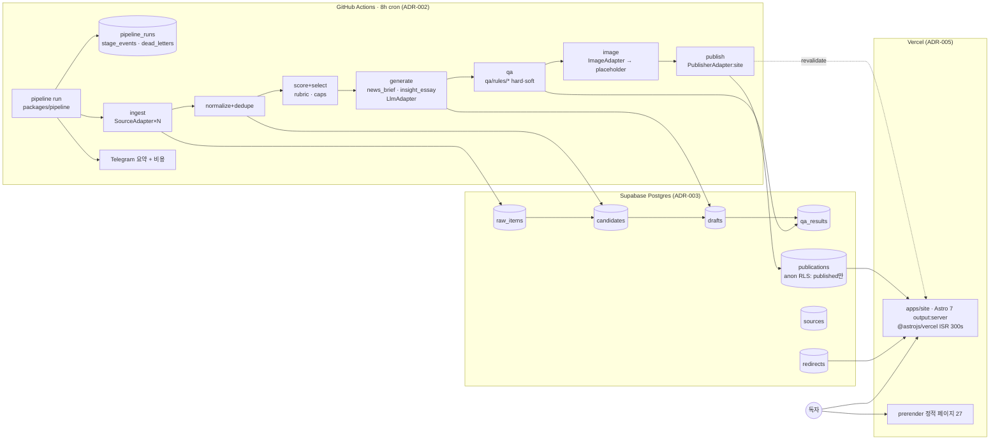

# 목표 아키텍처 (Phase 1 설계, 구현 전)

결정 근거: ADR-001(워크스페이스), ADR-002(GitHub Actions 런타임), ADR-003(Supabase 모델), ADR-004(QA 게이트), ADR-005(SSR/ISR 발행), ADR-006(Strangler), ADR-007(원장·알림·비용).

## 1. 전체 흐름

핵심 성질:

- **서빙과 생산의 분리(P1)**: 사이트는 `publications`·`redirects`만 읽는다. 파이프라인은 DB에만 쓴다. 파이프라인이 죽어도 사이트는 마지막 발행 상태를 ISR 캐시·DB에서 서빙한다. 빌드는 코드 변경 때만.
- **단일 Stage 인터페이스(P2)**: 7개 Stage가 모두 `run(input, ctx) → output`, 입출력 zod 검증, 아이템 단위 멱등 키.
- **어댑터(P3)**: Source(rss/html/api), Llm(anthropic 기본), Image(placeholder 기본, openai 선택), Publisher(site; 외부 블로그·SNS는 인터페이스만).
- **설정 > 코드(P4)**: `config/pipeline.yaml`(스케줄·캡·예산·플래그), `sources.yaml`, `scoring.yaml`, `qa.yaml`, `redirects.yaml`.
- **Fail-safe(P5)**: 아이템 실패는 `dead_letters`로, 소스 실패는 `sources.fail_streak`로, 이미지 실패는 플레이스홀더로. 런 전체를 죽이는 경로는 설정 로드 실패·DB 연결 실패 두 가지뿐이며 둘 다 원장 `failed`로 기록된다.
- **재현(P6)**: `fixtures/`의 녹화 RSS·HTML·LLM 응답으로 `--replay` 실행, CI 네트워크 0.
- **관측(P7)**: 런 시작 시 원장 선기록, 단계별 이벤트, Telegram 요약, 달러 예산.

## 2. 모듈 책임표

| 모듈 (패키지/경로) | 책임 | 입력 → 출력 | 대체하는 레거시 | Phase 3 |
|---|---|---|---|---|
| `packages/shared/schema` | zod 스키마(테이블 Row/Insert, NewsBrief, InsightEssay, 설정) | — | `scripts/lib/normalize.mjs` 일부, 각 모듈의 암묵 계약 | 2 |
| `packages/shared/contracts` | `Stage`, `SourceAdapter`, `LlmAdapter`, `ImageAdapter`, `PublisherAdapter`, `QaRule` 인터페이스 | — | 없음 | 2 |
| `packages/shared/config` | YAML 로더 + zod 검증 + 기능 플래그 | 파일 → typed config | `scripts/lib/constants.mjs`(env 산재) | 2 |
| `packages/pipeline/bin/pipeline.mjs` | CLI: `run [--stage] [--dry-run] [--fixture] [--replay]` | argv → exit code | `scripts/pipeline.mjs`, `run-subscription-news.mjs`, `subscription-job.mjs` | 2 |
| `packages/pipeline/src/ledger` | `pipeline_runs`·`stage_events`·`dead_letters` 선기록·갱신, funnel 집계 | 단계 이벤트 → DB | `pipeline-state.json` writer 3종, `record-pipeline-heartbeat.mjs` | 2/3i |
| `stages/ingest` | 소스별 fetch·parse(어댑터), 소스 health 갱신, `raw_items` upsert | sources → raw_items | `fetch-feeds.mjs`, `source-registry.mjs`, `update-industry-headlines.mjs` | 3a |
| `adapters/source/{rss,html,api}` | 피드·페이지 수집 | url → items | `fetch-feeds.mjs` rss-parser, Epoch HTML 리더, `source-fetch.mjs` | 3a |
| `stages/normalize` | canonical URL, 본문 해시, 제목 유사도 near-dup, 발행본 중복 차단 | raw_items → candidates(미채점) | `normalize.mjs`, `fetch-feeds.mjs:343-348`, `curate.mjs:192-207` | 3b |
| `stages/score` | 루브릭 5축 점수·사유, tier, 사이클 선택 상한·하한, 탈락 사유 | candidates → selected | `relevance-classifier.mjs`, `rank.mjs`, `curate.mjs`, `config/relevance-routing-rules.yml`, `signalScoringPolicy.yml` | 3c |
| `stages/generate/news_brief` | `prompts/news_brief.md` + LlmAdapter → NewsBrief | selected → drafts | `content.mjs` enrichContent, `expert-lens.mjs`, `expert-insight-engine.mjs`, `anti-template-rewrite.mjs` | 3d |
| `stages/generate/insight_essay` | 트리거(인사이트 잠재력 ≥ 설정, 일 상한), `content/voice/josh_voice.md`, 템플릿 | selected → drafts | `authored-column-engine.mjs`, `authored-column-policy.mjs`, `claim-ledger.mjs`, `config/editorial/persona-charter.json` | 3e |
| `stages/image` | ImageAdapter 체인, provenance, alt text, 플레이스홀더 | drafts → drafts(image) | `image-generator.mjs`, `codex-image-provider.mjs`, `image-providers/*`, `prepare-static-images.mjs` | 3f |
| `qa/rules/*` + `qa/run` | 1규칙 1파일, hard/soft, `qa_results` 영속, human-review 큐 | drafts → verdict | 게이트 8파일 + 금칙어·정책 YAML(`04-qa-gates` 표) | 3g |
| `publishers/site` | `publications` upsert(slug 충돌 방지), redirects, ISR revalidate 호출 | qa-passed → publications | `archive-store.mjs`, `state-store.mjs`, `authored-column-store.mjs`, `restore-eia-public-inventory.mjs`, `rebuild-taxonomy-pages.mjs`, `sitemap-builder.mjs` | 3h |
| `publishers/{blog,social}` | 인터페이스만 | — | 없음 | 3h(스텁) |
| `notify/telegram` + `budget` | 런 요약·실패 알림, 달러 누계·상한 가드 | ledger → 메시지 | `send-telegram-photo.mjs`(미호출), `llm-budget.mjs`, `operations-monitor.mjs`, `check-operations.mjs` | 3i |
| `apps/site/src/lib/publications.ts` | Supabase anon 읽기, ISR, 빈 상태 렌더 | DB → 페이지 | `src/data/*.json` import, `astro.config.mjs:14-40` 빌드 시 읽기, `api/admin/_github.js` | 2/3h |

## 3. Phase 0 funnel이 새 구조에서 기록되는 방식

| 컬럼 | 기록 지점 | 비고 |
|---|---|---|
| `sources_configured / ok / failed` | `stages/ingest` 종료 이벤트 `counts` | Phase 0 D3 해소 |
| `items_fetched / items_new` | ingest(`raw_items` upsert 결과: inserted vs existing) | |
| `items_scored / passed_gate` | `stages/score` (`candidates` 행 수, `selected=true`) | |
| `drafts` | `stages/generate` (`drafts` 행 수) | |
| `qa_passed` | `qa/run` (hard 전부 pass) | |
| `published` | `publishers/site` (`publications` upsert 수) | |
| `top_error` | `dead_letters` + `qa_results` reason_code 최빈값 | |
| 비용·토큰 | LlmAdapter 반환값 누계 | Phase 0에서 0이던 항목 |

## 4. 런타임 경계

| 경계 | 내용 |
|---|---|
| GitHub Actions ↔ Supabase | service role 키(Actions secret), 쓰기 전용 역할로 제한 검토 |
| Vercel ↔ Supabase | anon 키 + RLS(`publications` published만) |
| 파이프라인 ↔ Vercel | revalidate 호출(bypass token). 실패해도 ISR 만료로 자연 갱신 |
| 파이프라인 ↔ LLM/이미지 API | 어댑터 뒤, 비용 누계, 재시도 2회·백오프 |
| CI ↔ 외부 | 없음(fixture replay) |
